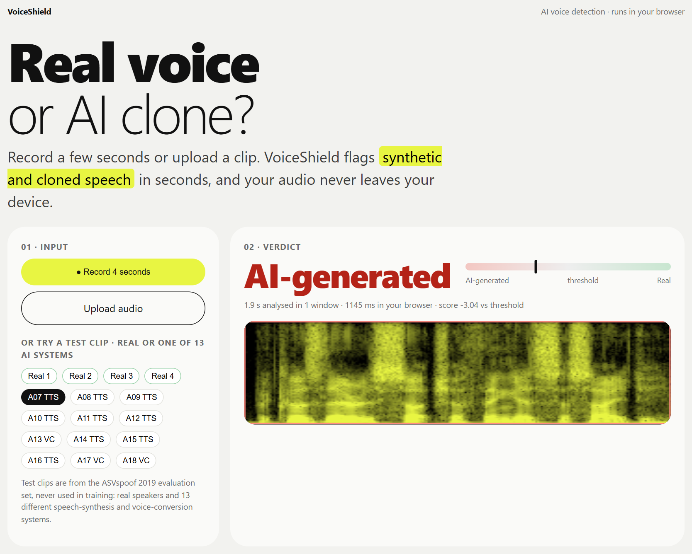
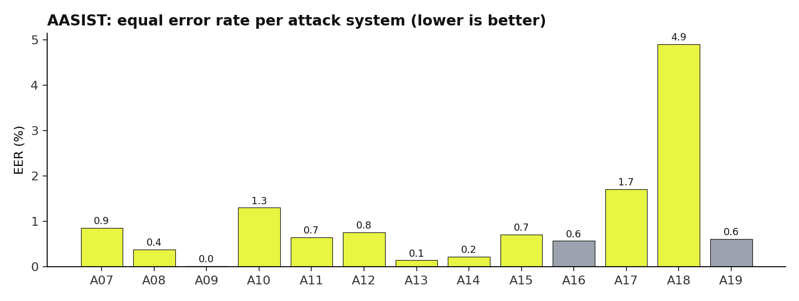

# VoiceShield

**Real voice, or AI clone?** VoiceShield detects synthetic and cloned speech (text-to-speech and voice
conversion) from a few seconds of audio.

**[▶ Try the live demo](https://priyanshu-singh-git.github.io/voiceshield/)** — record, upload, or try a test
clip. The model runs in your browser; your audio never leaves your device.



## Results

Trained and evaluated on **ASVspoof 2019 LA** — the standard anti-spoofing benchmark: 13 attack systems
(text-to-speech + voice conversion), **11 never seen during training**. The evaluation set is 7,355 real and
63,882 AI clips. All numbers are measured by `eval/evaluate.py`; the pass/fail threshold is fixed on the
separate development set.

| Model (built from scratch) | Params | EER ↓ | min t-DCF ↓ |
|---|---|---|---|
| **AASIST** | 298k | **1.40%** | 0.0424 |
| AASIST-L | 85k | 1.61% | 0.0491 |
| LFCC + LCNN | 158k | 5.75% | 0.1665 |
| RawNet2 | 17.6M | 6.04% | 0.1421 |
| *AASIST (authors' pretrained, reference)* | *298k* | *0.83%* | *0.0275* |

At a fixed operating point, the AASIST model **catches 83.9% of AI clips while flagging only 0.14% of real
voices** (low false alarms matter for fraud screening). My AASIST reaches 1.40% EER; the paper's 0.83% used
100 training epochs, while mine ran 38 within Kaggle's 12-hour session limit. My implementation reproduces
the authors' released model exactly (score difference < 0.0001).



**Honest finding:** nearly every attack is caught below 2% EER, but **A18 (i-vector voice conversion) is the
hardest at 4.9%** — a known weak spot for spectral countermeasures.

## How it works

VoiceShield is a from-scratch PyTorch re-implementation of **AASIST** (Jung et al., ICASSP 2022):

1. **Raw waveform in** — no hand-made features; 4 seconds of 16 kHz audio.
2. **Learnable band-pass filters** — 70 SincConv filters split the signal into frequency bands.
3. **Residual encoder → graph attention** — one graph over frequency bands, one over time frames, each with
   attention over fully-connected nodes.
4. **Heterogeneous graph fusion** — a stacking graph with learned master nodes combines both views and scores
   bona fide vs spoof.

The idea: vocoders and voice-conversion systems leave tiny spectral/temporal artefacts that ears miss but a
graph-attention network can learn. Also implemented for comparison: **LFCC+LCNN** (the ASVspoof baseline),
**RawNet2**, and **AASIST-L** (the lightweight 85k-param variant).

## Run it yourself

```bash
pip install -r requirements-dev.txt
# ASVspoof 2019 LA (ODC-By licence). Protocols + a few demo clips suffice for eval/demo;
# full training needs the train/dev/eval flac (see train/README or use a Kaggle mirror).
bash  # train all four models (GPU):
python train/train_cm.py --model aasist --root <LA_root> --out out/aasist --epochs 100 --bs 24
python eval/evaluate.py out/*/scores_eval.txt          # EER, min t-DCF, per-attack
python deploy/export_web.py --ckpt out/aasist/best.pt  # ONNX + browser demo in docs/ (parity-checked)
pytest -q tests
```

| Path | What |
|---|---|
| `src/voiceshield/` | SincConv, LCNN, RawNet2, AASIST/AASIST-L, LFCC features, EER + t-DCF metrics |
| `train/` | training loop (dev-EER checkpointing, weighted loss, cosine schedule, AMP) |
| `eval/` | official-style evaluation (EER, min t-DCF with ASVspoof cost model, per-attack) |
| `deploy/` | ONNX export, Kaggle GPU job runner, browser parity test |
| `docs/` | browser demo (ONNX Runtime Web), served by GitHub Pages |
| `presentation/` | deck builder (`deck.pptx`, slide PNGs, PDF) |

## Limits (stated plainly)

- Trained on ASVspoof 2019 LA: English read speech, 2019-era synthesis. **Newer commercial voice-cloning
  tools can be harder to catch** — treat VoiceShield as a screening signal, not proof.
- Robustness to phone codecs, noise and reverb is not yet measured (on the roadmap).
- Single run per model; my models trained fewer epochs than the published recipe.

## Licence and data

Code and trained weights: [PolyForm Noncommercial 1.0.0](LICENSE). Data: ASVspoof 2019
([ODC-By](https://datashare.ed.ac.uk/handle/10283/3336)). Reference weights: clovaai/aasist (MIT), used for
comparison and to verify the implementation.

---

**Need voice-fraud screening for calls, voice logins, or uploads?** I build and deploy custom detectors.
Built by **Priyanshu Singh**, freelance AI / ML engineer · [GitHub](https://github.com/Priyanshu-Singh-git)
